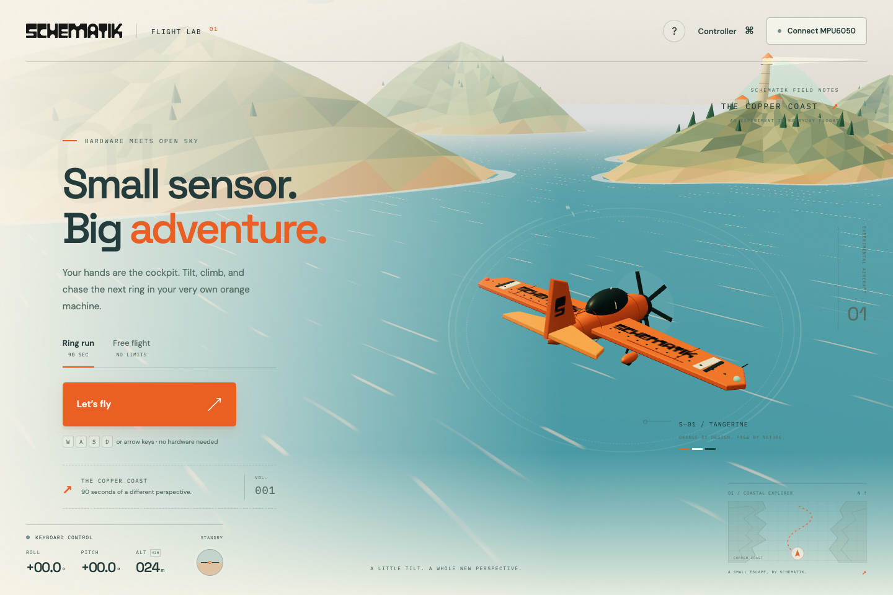
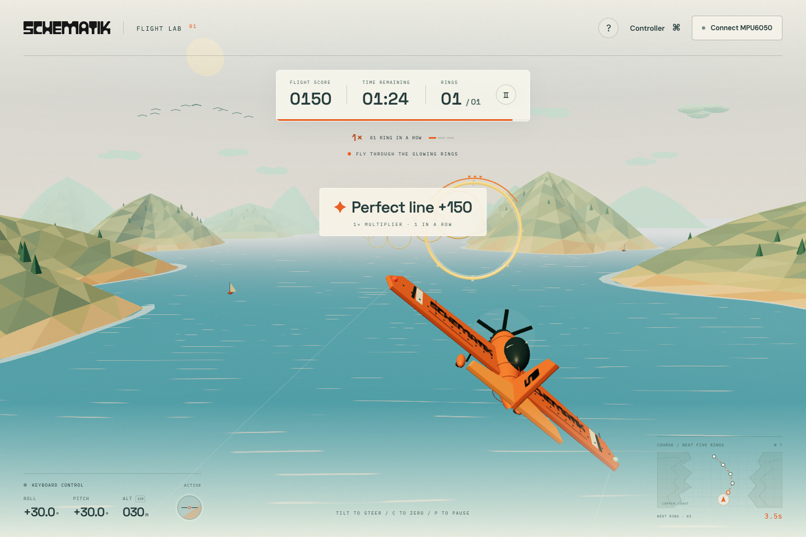

# Schematik Skyflight

**Small sensor. Big adventure.**

A local, offline-capable 3D flight game built with Three.js, Vite, and vanilla JavaScript. Fly an orange Schematik stunt plane above the Copper Coast using your keyboard, touch controls, or a real MPU6050 tilt controller.



## The experience

- **Copper Coast:** procedural islands, warm lighting, shimmering ocean, shoreline foam, a lighthouse outpost, sailboats, and seabirds.
- **Tangerine S–01:** branded orange aircraft, mechanical details, animated propeller, navigation lights, and wingtip trails.
- **Ring run:** 90 seconds, perfect-pass bonuses, combos up to 5×, and a locally saved personal best.
- **Free flight:** no timer or course. Just you and the coastline.
- **Flight instruments:** roll/pitch telemetry, attitude indicator, next-five-rings chart, progress/combo feedback, and a flight-log results card.
- **Real tilt:** USB Web Serial, automatic neutral calibration, sensitivity, axis inversion/swap, and keyboard fallback.
- **Considered details:** responsive portrait/landscape layouts, split touch controls, reduced-motion support, and automatic safety pauses.

No account, API key, cloud backend, or runtime CDN. Fonts, branding, models, and scenery are served locally. Internet access is needed for the initial dependency installation, not for flying afterward.



## Quick start

Use **Node.js 22.12+** (Node 24 LTS also works).

```sh
git clone https://github.com/sparklabhqx/schematik-skyflight.git
cd schematik-skyflight
npm ci
npm run dev -- --port 5178
```

Open **http://localhost:5178**, then click **Let’s fly**. No hardware is required.

Desktop **Chrome or Edge** is required for USB tilt control. Other WebGL2-capable browsers can use keyboard/touch controls. Web Serial requires localhost or HTTPS; an ordinary HTTP LAN address is not enough.

### Production build

```sh
npm run build
npm run preview -- --port 5178
```

`dist/` is generated locally and is not committed. Rebuild it after source changes.

**macOS shortcut:** double-click `Start Skyflight.command`. It prefers a prebuilt `dist/` served with Ruby/WEBrick when available, otherwise falls back to npm. A fresh clone therefore needs Node.js for initial setup. Keep its Terminal window open while playing. All included servers bind to loopback, not the LAN.

## Controls

| Control | Action |
|---|---|
| W / ↑ | Climb |
| S / ↓ | Descend |
| A / ← | Steer left |
| D / → | Steer right |
| P / Escape | Pause / resume |
| C | Re-center a live tilt controller |
| Touch arrows | Bank and climb/descend on touchscreen devices |

- **Relaxed handling:** forward speed 24, lateral/vertical velocity targets 16/12. The first ring arrives after 5 seconds, subsequent rings about every 4.6 seconds.
- **Scoring:** 100 points per ring, plus 50 for a center pass. Consecutive hits build a multiplier up to 5×; a miss resets the combo, not the score.
- Leaving the window/tab, opening settings, or losing the sensor stream pauses the flight. Reconnection never silently resumes it.
- System **Reduce Motion** stills the landing showcase and reduces decorative motion while preserving flight and live controls.

## Optional hardware controller

### Parts and wiring

- Seeed Studio **XIAO ESP32-C6**
- **MPU6050 / GY-521** breakout
- USB data cable and jumper wires

This is the verified XIAO wiring used by the included firmware:

| MPU6050 | XIAO ESP32-C6 |
|---|---|
| VCC | **3.3V** |
| GND | GND |
| SDA | **D8 / GPIO19** |
| SCL | **D7 / GPIO17** |
| AD0 | GND → I²C address `0x68` |
| INT | Not connected |

**D labels are not GPIO numbers.** GPIO19/17 is the primary pair, not GPIO6/7. The ESP32-C6 sketch also checks GPIO22/23, GPIO16/17, and GPIO6/7 for alternate layouts; it probes addresses `0x68` and `0x69` and reports failures instead of generating fake tilt readings.

### Firmware setup

Open [`firmware/SchematikFlightController/SchematikFlightController.ino`](firmware/SchematikFlightController/SchematikFlightController.ino) in Arduino IDE:

1. Install **esp32 by Espressif Systems** through Boards Manager.
2. Select **XIAO_ESP32C6**, the board's USB port, and **USB CDC On Boot → Enabled**.
3. Close any serial monitor, upload, and hold the sensor still for about two seconds.
4. In desktop Chrome/Edge, click **Connect MPU6050** and select the board.
5. Hold a comfortable grip and press **C**, or choose **Controller → Zero current tilt**.

Uploading replaces existing board firmware; back up anything important first. Once this controller firmware is installed, visual/game updates do **not** require reflashing.

The sketch uses only the Arduino core and `Wire`. It sends newline-delimited `roll,pitch` degrees at **115200 baud**, approximately **50 Hz**. The first valid sample becomes neutral; controller preferences are stored locally. Live sensor input takes priority over keyboard steering.

### Other boards and existing firmware

Uno / classic Nano are supported on **A4/A5**. The bare MPU6050 is **not 5V tolerant**: check your breakout's regulator/pull-ups and use a suitable bidirectional I²C level shifter when connecting to a 5V board. The sketch disables AVR internal pull-ups.

Existing firmware can send any of these formats at 115200 baud:

```text
12.50,-4.25
12.50,-4.25,0.00
{"roll":12.50,"pitch":-4.25}
```

Angles must be in degrees within −180…180. An optional third CSV angle is ignored. `#` diagnostic lines and corrupt/oversized messages are discarded. Raw six-axis accelerometer/gyro values are not treated as angles.

### Real telemetry, simulated flight

The sensor supplies roll and pitch. It does **not** provide altitude, GPS, or drift-free absolute yaw. Altitude, distance, and the course chart are simulated game values. This is forgiving arcade flight, not a physically accurate simulator.

## Troubleshooting

- **Port busy:** close Arduino Serial Monitor and any other application reading the board. Only one application can own the serial port.
- **Connected but no data:** check 3.3V, GND, SDA/SCL, USB CDC, and the serial format. Firmware diagnostics identify wiring/read errors. A stalled stream pauses flight and enables explicit keyboard fallback.
- **Wrong steering direction:** use Controller settings to swap/invert axes, adjust sensitivity, or zero the grip.
- **No Web Serial:** use desktop Chrome/Edge on localhost or HTTPS, or play with keyboard/touch.
- **Blank 3D:** enable browser hardware acceleration. WebGL2 is required.
- **Graphics context lost:** reload the page; the flight pauses rather than continuing blindly.

## Development and tests

```sh
npm test             # game physics, course/scoring, sensor mapping, serial parsing
npm run test:e2e     # Playwright; installed Google Chrome required
npm run build
```

The suite includes **11 unit tests and 8 browser tests** covering rendering, keyboard/touch steering, scoring, complete results/restart, calibration and stale-stream handling, modal/blur/hidden-tab safety, reduced motion, and small-screen layouts. Browser screenshots are written to `test-results/`.

USB integration is tested with a mocked stream. Automated tests do not replace a physical wiring/controller check. CI runs unit tests and the production build.

### Structure

| Path | Purpose |
|---|---|
| `src/scene.js` | Procedural aircraft, coastline, water, lighting, rings, camera and effects |
| `src/game.js` | Renderer-independent flight model, course and scoring |
| `src/main.js` | UI, inputs, calibration and stream-loss safety |
| `src/serial.js` | Bounded CSV/JSON framing and Web Serial lifecycle |
| `src/style.css`, `index.html` | Editorial interface and responsive layouts |
| `public/` | Locally served Schematik branding |
| `firmware/` | Optional ESP32-C6 / Uno / Nano controller sketch |
| `tests/` | Unit and browser regression tests |

Private device backups, hardware logs, machine-specific deployment notes, generated firmware binaries, and local verification artifacts are intentionally excluded from this repository.

## Credits and branding

Built with [Three.js](https://threejs.org/), [Vite](https://vite.dev/), and locally bundled DM Sans, Space Grotesk, and IBM Plex Mono fonts. Dependencies retain their respective licenses.

Schematik branding remains its owner's property. This is an independent local experiment, **not an official Schematik product release**. Repository visibility does not grant trademark rights.
